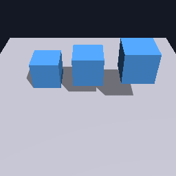
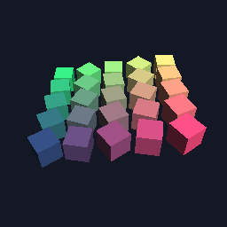
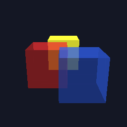
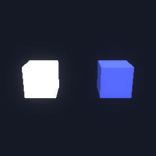
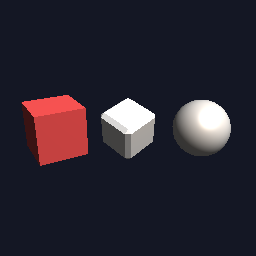
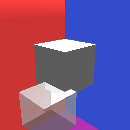
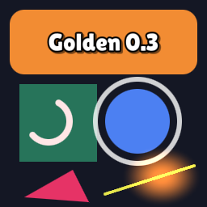

# WLWengine

[](https://github.com/aboelbisher/WLWEngine/actions/workflows/ci.yml)
[](https://github.com/aboelbisher/WLWEngine/releases)


[](LICENSE)


A C++20 / OpenGL game engine for mobile-first 3D and 2D games. One renderer serves desktop GL 3.3 and
GLES 3.0, so the same game runs on Windows, macOS, Linux and Android (iOS is next). It's a plain CMake
library (`wlw::wlw`): Visual Studio, Xcode, CLion and VS Code all open the same `CMakeLists.txt`, and games
include it as a git submodule.

<table>
  <tr>
    <td></td>
    <td></td>
    <td></td>
    <td></td>
  </tr>
  <tr>
    <td></td>
    <td></td>
    <td></td>
    <td></td>
  </tr>
</table>

<sub>Shadows, instancing, sorted transparency, HDR bloom, lit primitives, skybox, sprite batches and the 2D canvas.
These are the golden images from the GPU test suite: CI renders each scene on Mesa llvmpipe and compares it with
these pictures pixel by pixel.</sub>

## Features

- **Rendering**: forward renderer for GL 3.3 core and GLES 3.0 from one code path. Directional, point and spot
  lights, PCF shadow maps, instancing (`MultiMeshInstance3D`), sprite batches, a skybox, draw lists sorted by
  program / texture / depth, frustum culling, offscreen viewports, render scale.
- **Post-processing**: pass chains planned on the CPU, HDR (RGBA16F) scene pictures, bloom (13-tap down / tent up),
  tone mapping, blur and threshold (metaballs / liquid), all as data (`post_settings.h`).
- **Shaders**: one text per shader (`shader_type mesh | canvas | post`) with `#include`, variants, per-node
  `instance uniform`s and `file:line` errors; every engine shader is compiled as GLSL 3.30 and GLSL ES 3.00 in CI.
- **Scene**: a node tree like Godot's (`Node3D`, mesh / multimesh / sprite / light / camera nodes) with cached
  transforms, ids, layers and fly / orbit / follow camera controllers. Z up, +Y forward, right-handed.
- **App framework**: `Application` with Systems and a Screen stack, fixed-step time with hit-stop and slow motion,
  frame pacing (Swappy on Android), adaptive quality levels driven by GPU timers, cvars, a console and save files.
- **2D UI**: a batched canvas (rounded rects, gradients, SDF text, vector shapes, images, shader rects) plus
  immediate-mode widgets (buttons, switches, dialogs, cards, badges) with themes and safe areas.
- **Audio**: miniaudio mixer with buses, pitch / pan, streamed music with gapless intros and crossfades, and a live
  mix (bus low / high-pass filters, gain, ducking).
- **Effects and animation**: particle systems, flow particles (20k dots along paths), tweens, easing, timelines,
  screen shake.
- **Tools**: Dear ImGui debug UI and engine panel, Tracy profiling (CPU + GPU zones), structured logging, asserts,
  benchmarks.
- **Game kit** (`wlw::kit`): save stores with migrations, progress and daily streaks, AdMob ads.

## Quick start

```sh
git clone --recursive git@github.com:aboelbisher/WLWEngine.git
cd WLWEngine
git lfs pull
```
(Already cloned? `git submodule update --init --recursive`.) vcpkg bootstraps itself on the first configure and
installs GLFW into `build/<preset>/vcpkg_installed/`; everything else is vendored in `third_party/`.

**Visual Studio 2026**: *File → Open → Folder…* on the repo root, pick the `Windows Debug` preset and build.

**Command line** (a Developer PowerShell on Windows; use the `debug` / `release` presets on macOS and Linux):
```sh
cmake --preset windows-debug
cmake --build --preset windows-debug
ctest --preset windows-debug                       # unit + GPU tests
./build/windows-debug/samples/snake/wlw_snake.exe  # the sample game
```

**Xcode**: `cmake --preset xcode`, then open `build/xcode/WLWengine.xcodeproj`.

**Android**: set `ANDROID_NDK_HOME` to NDK 30, then `cmake --preset android-arm64` and
`cmake --build --preset android-arm64`. A game's Gradle project packages the result.

## Using the engine in a game

Games live in their own repos and add the engine as a submodule:

```cmake
add_subdirectory(external/WLWengine)
wlw_add_game(my_game SOURCES main.cpp ASSETS assets)   # .exe on desktop, .so on Android
```

A game adds `wlw::app::System`s (they run for the app's whole life; `Screen`s are its states) that override the
hooks they need; `App()` gives the services (window, input, audio, screens, time, quality, config):

```cpp
#include "wlw/app/entry_point.h"

class MyGame : public wlw::app::System {
 public:
  void OnStart() override {}                 // build the scene
  void OnFixedUpdate(float dt) override {}   // game logic, constant dt
  void OnUpdate(float dt) override {}        // per frame: input, camera
  void OnRender(float alpha) override {}     // interpolate state into nodes
};

std::unique_ptr<wlw::app::Application> MakeApp() {
  wlw::app::AppConfig config;
  config.name = "My Game";  // the save folder and the window title
  auto app = std::make_unique<wlw::app::Application>(config);
  app->AddSystem<MyGame>();
  return app;
}
WLW_MAIN(MakeApp)   // main() on desktop, android_main() on Android
```

## Platforms

| | Window / context | Graphics | Input | Frame pacing |
|---|---|---|---|---|
| Windows, macOS, Linux | GLFW | OpenGL 3.3 core (glad) | keyboard, mouse | vsync interval or a precise limiter |
| Android | NativeActivity + EGL | OpenGL ES 3.0 | touch (swipes, taps), keys | Swappy |

All per-OS code lives in `engine/wlw/platform/`; everything else is shared.

## Repository layout

| Path | What |
|---|---|
| `engine/wlw/` | Engine source, by module: `app`, `rendering`, `scene`, `ui`, `audio`, `fx`, `anim`, `input`, `core`, `math`, `debug`, `utils`, `platform`. Include as `#include "wlw/scene/window.h"` |
| `kit/wlw/kit/` | Game-level building blocks (saves, progress, daily streaks, ads); a separate target on top of the engine |
| `samples/snake/` | A small sample game, built when the engine is the top-level project |
| `tests/` | Unit tests (doctest, no GPU) and golden-image GPU tests (`tests/gpu/`) |
| `benchmarks/` | nanobench benchmarks with baselines for desktop, Linux CI and phones |
| `third_party/` | Vendored libraries: glm, glad, stb, tinygltf, nlohmann json, miniaudio, Dear ImGui, doctest, nanobench, Tracy, Swappy ([versions and licences](third_party/README.md)) |
| `cmake/` | `wlw_add_game()`, `wlw_add_assets()`, warnings, formatting, embedded shaders |

## Quality

Every push runs clang-format, Windows MSVC Debug, Linux clang with ASan + UBSan and golden images (llvmpipe under
xvfb), and an Android arm64 build. Warnings are errors everywhere. Benchmarks run on Linux CI and are compared
against stored baselines.

## Status

Pre-1.0: the API still changes between minor versions, and every change is listed in
[CHANGELOG.md](CHANGELOG.md) with a migration note. One minor version per finished roadmap phase; the latest is
[v0.3.0](https://github.com/aboelbisher/WLWEngine/releases/tag/v0.3.0). [ROADMAP.md](ROADMAP.md) holds the plan:
next come an editor for the engine's games, then iOS. The engine is used by Bluzzle, a block puzzle for phones.

## License

[MIT](LICENSE). The vendored libraries in `third_party/` keep their own licences (MIT, BSD-3-Clause, Apache-2.0,
public domain), listed in [third_party/README.md](third_party/README.md).
